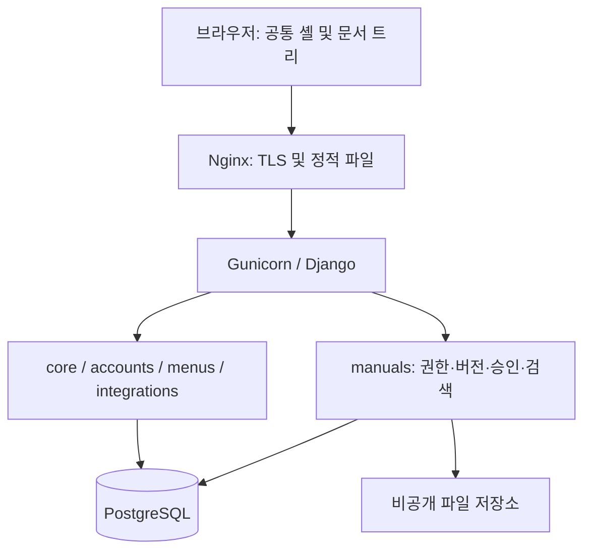

# 시스템 아키텍처

## ADR-001: 독립 설치형 모듈형 모놀리스
Python 3.12, Django 5.2 계열, uv 잠금 파일, Django Templates. 개발 SQLite, 운영 PostgreSQL. 단일 조직 설치형으로 시작한다. 화면·폼은 경계 검증, 서비스는 권한·트랜잭션·상태 전이, 모델은 DB 정합성을 책임진다.

core는 브랜딩·감사, accounts는 로컬 인증·그룹, menus는 동적 3-depth 공통 탐색, integrations는 암호화된 연결·리소스·기능 바인딩을 담당한다. manuals는 도메인만 담당한다. 공통 앱이 manuals 모델을 직접 요구하는 구조를 피한다.

## ADR-002: 환경설정 구분
배포 비밀은 env(DJANGO_SECRET_KEY, INTEGRATION_ENCRYPTION_KEY, DATABASE_URL). 조직명·색상·메뉴·그룹·업무별 연결은 관리자 UI. 연결 비밀은 Fernet 암호화, 일반 옵션과 분리. 초기 외부 제공자 테스트는 설정 검증이며 외부 API 인증 성공을 의미하지 않는다.

## ADR-003: 편집기
첫 구현은 로컬 번들 Tiptap 블록 편집과 Markdown 모드/정제 미리보기. 저장은 Markdown으로 변환하며 복잡한 HTML 셀·서식의 완전 보존은 약속하지 않는다. 게시 리비전과 최신 초안은 별도 포인터로 유지한다.

## 대안
| 대안 | 채택 여부/이유 |
|---|---|
| SPA + REST | 초기 제외: 인증·번들·API 경계를 늘리지 않음 |
| Celery/Redis | 초기 제외: 장기 실행 변환 작업 도입 시 검토 |
| 멀티테넌트 | 초기 제외: 단일 조직 보안 경계에 집중 |
| 공개 미디어 alias | 금지: 로그인·공간 권한 다운로드 필요 |
| Docker 운영 | 선택 사항: 기본 운영은 Ubuntu/systemd |

확장점은 SSO, private S3 adapter, 검색 service, provider adapter이다. 어댑터 존재와 해당 외부 연동 완성을 구분한다.
