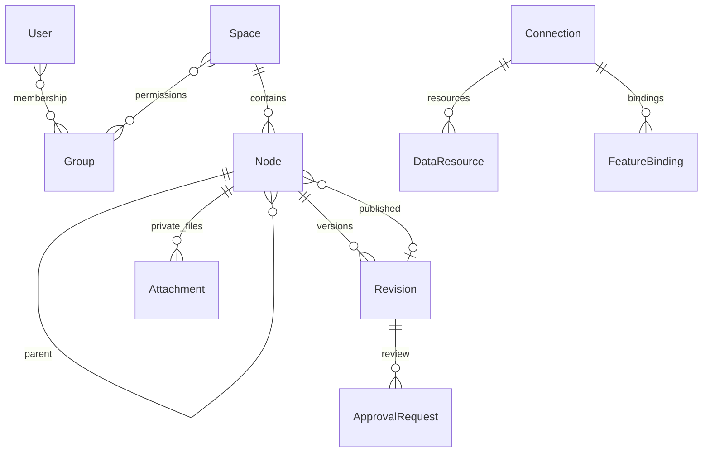

# 데이터 모델 및 정합성

구현 필드의 최종 명칭은 `apps/*/models.py` 및 migration을 따른다. 아래는 의미 계약이다.

| 엔터티 | 핵심 필드 및 제약 |
|---|---|
| Space | 제목/slug/활성/본인승인 허용, 열람·편집·관리 그룹 |
| Node | 공간, 부모, folder/page 유형, 정렬, slug, 보관/삭제 상태, 최신/게시 리비전 참조 |
| Revision | 문서, 버전, Markdown/정제 HTML, 작성자·시간; 기존 본문 변경 대신 새 버전 |
| ApprovalRequest | 정확한 revision, 요청자, 처리자·시간·의견, 상태 |
| Attachment | 문서, 비공개 파일, 원본명·크기·업로더 |
| AuditEvent | 행위자, 시각, 동작, 대상, 정제된 메타데이터; 비밀/본문 제외 |
| Connection | 제공자, 소유자, 공유/그룹, 암호화 비밀, 일반 config |
| DataResource | 연결, 외부 리소스 식별자, schema/options |
| FeatureBinding | 고유 feature code, 연결/리소스, 매핑, options, revision |

## 트리 정책
공통 메뉴는 최대 3단계. 매뉴얼 트리는 별도이고 논리 중첩을 허용하되 순환·다른 공간의 부모·페이지 아래 자식 정책을 검증한다. 이동은 하위 전체에 대한 공간 일관성을 검증한다. 부모 순환 검증과 승인/편집 충돌에 DB 트랜잭션을 적용한다. 대규모 동시 이동은 PostgreSQL 잠금 테스트가 필요하다.

## 게시 정책
열람자는 `published_revision`만 사용한다. 편집 권한 보유자만 draft/history를 확인한다. 승인 요청 대상은 revision ID로 고정하고 요청 이후 개정 시 새 개정본을 무조건 승인된 것으로 취급하지 않는다. 과거 버전 복원은 새 revision 생성으로 기록한다.

## 권한 상속
기본은 공간 그룹이며 노드별 사용자/그룹 allow/deny 레코드와 ancestor 평가를 제공한다. 시스템 superuser는 명시적 우회, 일반 staff는 기능별 정책을 적용한다. 열람, 편집, 관리 그룹의 합집합으로 문서 접근을 평가하며 편집·승인은 역할별 별도 검사한다. 공간 열람 권한이 외곽 경계이며 노드 allow로 비공개 공간을 열 수 없다. 대상 노드부터 조상까지 같은 action의 매칭 assignment 중 deny 하나라도 있으면 거부, deny 없고 allow 있으면 허용, 모두 없으면 공간 역할을 따른다. 노드 설정에서 사용자/그룹 ACL을 추가·삭제한다.

## 인덱스·삭제
공간/부모/정렬, 문서/버전, 승인 상태/시간, 감사 시각을 주요 조회 경로로 삼는다. 현재 migration의 실제 인덱스를 운영 성능검증에 확인한다. 외래키 삭제 정책으로 게시 리비전 고아 참조를 막는다. 보관/휴지통은 열람·검색에서 제거하고 복구는 권한을 재검사한다. 보존기간에 따른 영구 정리는 별도 정책 확정 전 실행하지 않는다.

## 실제 초기 추가 모델
`ManualFavorite`, `ManualRecentView`, `ManualPermissionAssignment`가 있다. 게시 포인터는 `ManualNode.published`, 최신은 `draft`, 별도 publication 테이블은 두지 않는다. slug는 전역 UUID로 링크 충돌을 방지한다.

기본 action 매핑: create/move/delete → edit, export/download_attachment → view. 명시 action 또는 기본 action assignment의 deny를 모두 우선한다.
